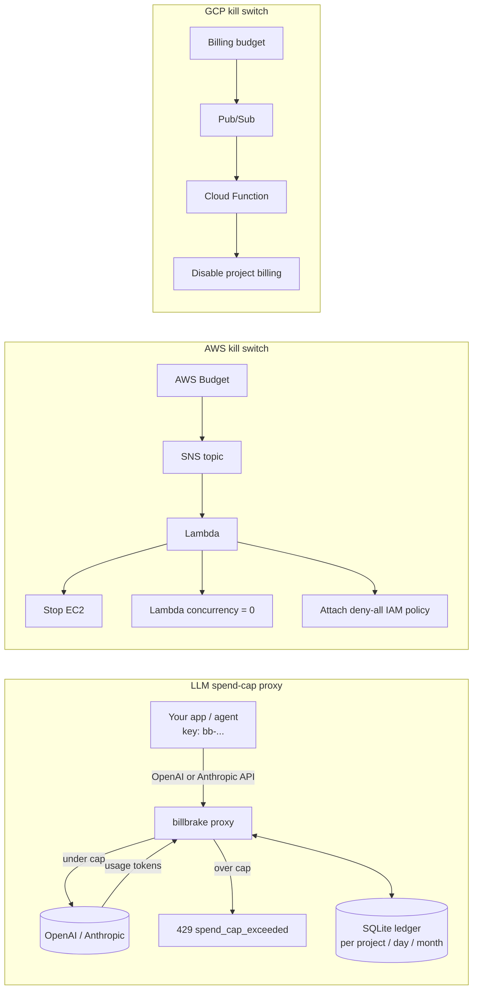

# billbrake

**Hard spend caps for LLM APIs and cloud bills.** Budgets send an email; billbrake stops the spending.

Cloud and AI providers mostly offer *alerts*, not *caps*. A leaked key, a runaway agent loop or a forgotten GPU
instance keeps billing while the alert sits in an inbox. billbrake puts an enforcing layer in the path:

1. **LLM spend-cap proxy** – an OpenAI-compatible + Anthropic reverse proxy. It prices every request from the
   provider's reported token usage, keeps a per-project ledger in SQLite, and returns `429 spend_cap_exceeded`
   *before* forwarding once a daily or monthly cap is reached. Streaming is supported.
2. **Cloud kill switches** – small functions wired to the provider's own budget alerts that *act*:
   - **AWS**: Budgets → SNS → Lambda that stops EC2 instances, sets Lambda concurrency to 0, and/or attaches a
     deny-all IAM policy to chosen roles/users.
   - **GCP**: Billing budget → Pub/Sub → Cloud Function that detaches billing from the project.

   Both default to **dry-run** and are deployed with the included Terraform.

> ⚠️ Status: v0.1, early. The proxy and kill-switch logic are unit-tested against mocked providers; they have not
> been battle-tested in production. Read the code before pointing it at anything you care about.

## Architecture



## Quickstart: LLM proxy

```bash
pip install git+https://github.com/hamarshehmhmd/billbrake
export OPENAI_API_KEY=sk-...        # real keys stay on the proxy
export ANTHROPIC_API_KEY=sk-ant-...
cp examples/billbrake.yaml .        # define projects, their proxy keys and caps
billbrake serve -c billbrake.yaml   # listens on 127.0.0.1:8787
```

Point clients at the proxy and give them the *billbrake* key, not the provider key:

```python
from openai import OpenAI
client = OpenAI(base_url="http://127.0.0.1:8787/v1", api_key="bb-demo-key")

import anthropic
claude = anthropic.Anthropic(base_url="http://127.0.0.1:8787", api_key="bb-demo-key")
```

Check spend: `billbrake status` or `GET /billbrake/status`. Clear a project: `billbrake reset demo`.

### How the cap works
- Before a request: if `spent + reserve_usd >= cap` → `429`, the provider is never called.
- `reserve_usd` is held for the request's duration so parallel requests can't all slip under the cap.
- After the response: actual cost from `usage` (input + cached + output tokens × price table) is recorded.
- Streams: `stream_options.include_usage` is injected for OpenAI chat; Anthropic `message_start`/`message_delta`
  usage is read from the SSE stream.
- Unknown models are rejected (configurable) so nothing goes through un-priced.
- Periods are UTC days and UTC months.

Limitations: a single in-flight request can overshoot the cap by its own cost (use `reserve_usd` to bound this);
prices in `pricing.py` are defaults you should verify; only chat/completions/embeddings/messages that return
`usage` are costed – other endpoints pass through and are counted at $0.

## Quickstart: cloud kill switches

```bash
cd terraform/aws
terraform init && terraform apply -var monthly_limit_usd=50 -var dry_run=true \
  -var stop_ec2=true -var 'lambda_functions=["my-fn"]'
```

```bash
cd terraform/gcp
terraform init && terraform apply -var project_id=my-proj -var billing_account=XXXXXX-XXXXXX-XXXXXX \
  -var monthly_limit=50 -var dry_run=true
```

Watch the function logs on the first alert, then flip `dry_run=false`. **Disabling GCP billing can lead to
resource deletion** – Google documents this behaviour. AWS alerts can lag actual usage by hours; the kill switch
caps damage, it does not make it zero.

## How it compares

| | Enforces a hard stop | LLM | AWS | GCP | Self-hosted |
|---|---|---|---|---|---|
| Provider budgets (AWS Budgets, GCP budgets) | alerts only (AWS Budget Actions can apply IAM/SCP) | – | ✓ | ✓ | – |
| OpenAI / Anthropic console limits | org-level, coarse | ✓ | – | – | – |
| [LiteLLM proxy](https://github.com/BerriAI/litellm) budgets | ✓ per key/team | ✓ (100+ providers) | – | – | ✓ |
| Helicone / Portkey gateways | rate limits & caching, caps vary by plan | ✓ | – | – | partial |
| **billbrake** | ✓ | OpenAI + Anthropic | ✓ | ✓ | ✓ |

If you already run LiteLLM, use its budgets – it is far more complete as an LLM gateway. billbrake aims to be
the small, single-purpose thing: one YAML file, one SQLite file, readable in an afternoon, plus the cloud
kill switches in the same repo so “never spend more than $X” is covered across LLM and cloud.

## Roadmap
- Per-key (not just per-project) caps and model allow-lists
- Postgres/Redis ledger for multi-instance deployments
- Webhook/Slack notification when a cap trips
- Azure kill switch; AWS SCP option for Organizations
- Auto-updated price table

## Contributing
See [CONTRIBUTING.md](CONTRIBUTING.md). MIT licensed.
